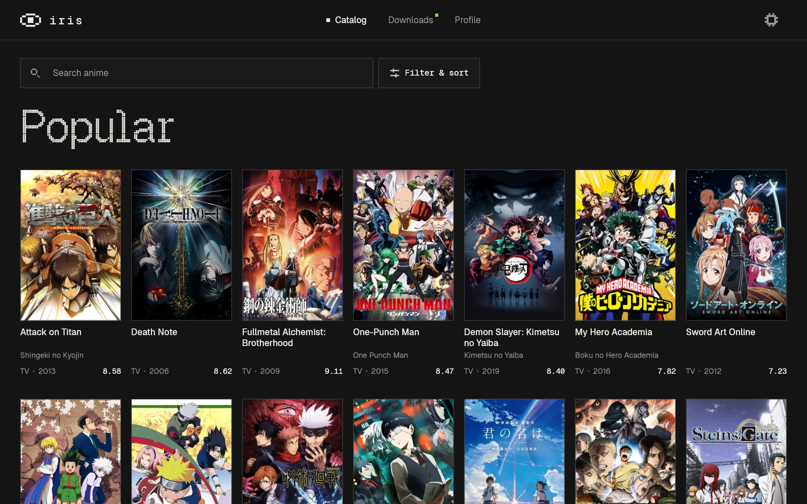
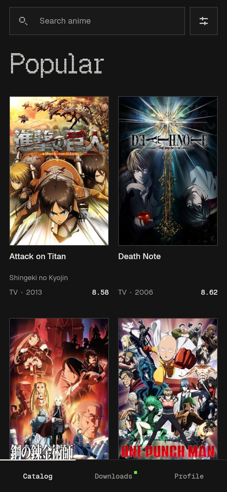
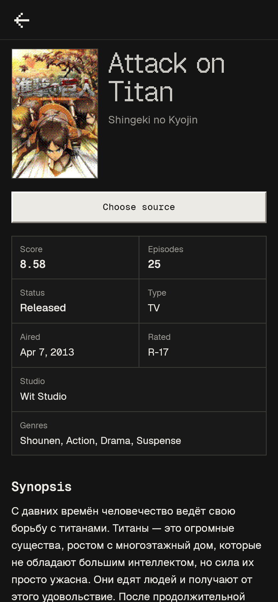
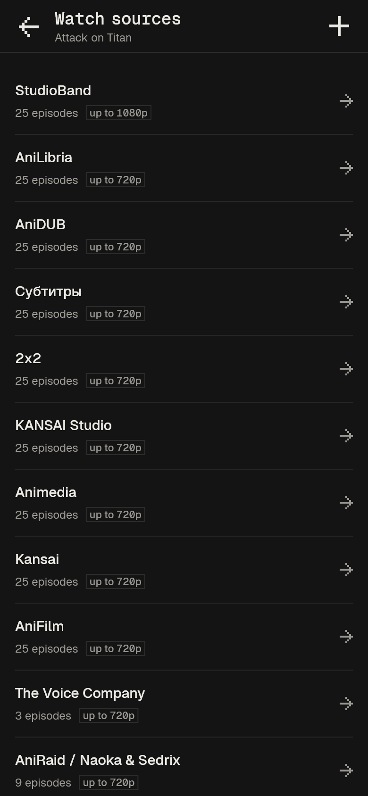
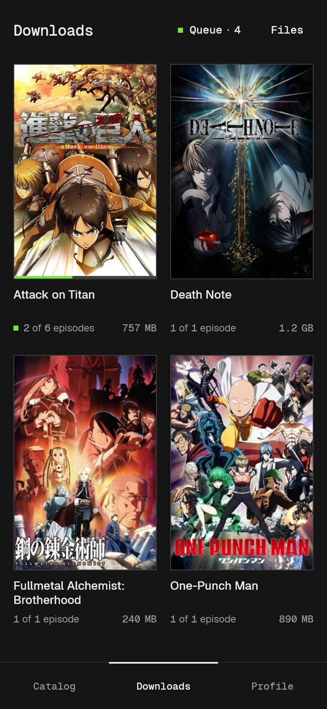
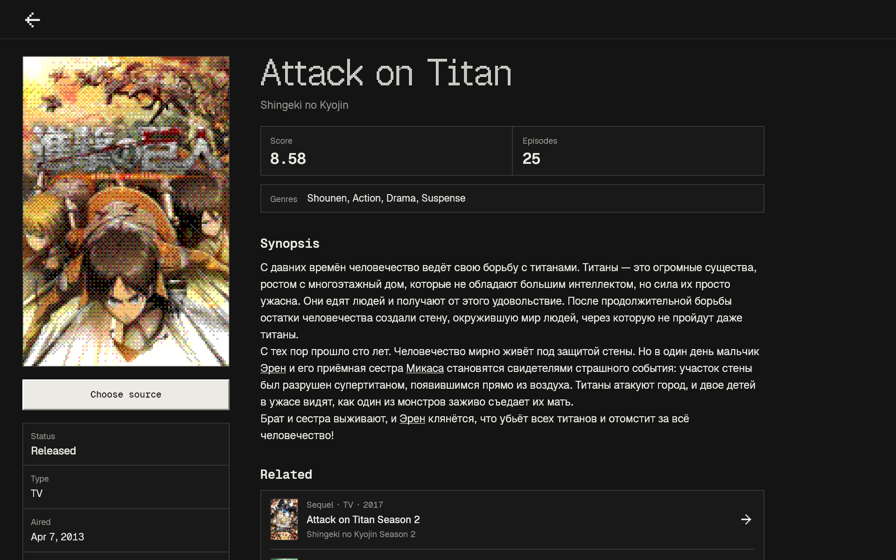
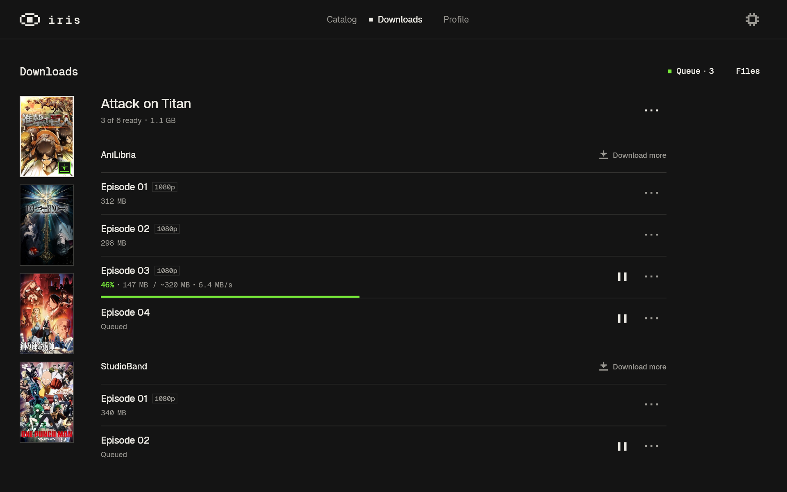

<p align="center">
  
</p>

<h1 align="center">iris</h1>

<p align="center">
  An ad-free anime client for Android, Windows, and iOS.<br>
  Browse the <a href="https://shikimori.io">Shikimori</a> catalog, stream from online sources and torrents in an in-app mpv player, download episodes for offline viewing, and sync your watch progress.
</p>

<p align="center">
  
</p>

<p align="center">
  
  
  
  
</p>

<p align="center">
  
  
</p>

The interface is available in English and Russian. Online sources provide Russian dubs and subtitles; torrents carry whatever audio and subtitle tracks their releases include.

## Features

- **Catalog & search.** Browse popular, top-rated, and recent anime with filters by type, status, genre, season, age rating, episode length, and your Shikimori list.
- **Title & character pages.** Synopsis, metadata, related titles, character pages, and Shikimori friends who have the title in their lists.
- **Online & torrent sources.** Watch or download from AniLibria, yummy_anime, AnimeJoy, and Nyaa, or attach your own magnet link or `.torrent` file to any anime.
- **In-app player.** Built on `mpv` (`media_kit`) with torrent streaming piece by piece, audio and ASS/SSA subtitle controls, opening skip via chapters or [AniSkip](https://api.aniskip.com), resume and next-episode prompts, touch gestures on phones, and picture in picture on Android, iOS 15+, and Windows.
- **Offline downloads.** Download online episodes and torrent files in a resumable queue with batch selection, drag reordering, and temporary cache cleanup. Completed files play from disk automatically.
- **Shikimori sync.** Manage status, score, and episode counts with automatic episode marking and an offline retry queue.
- **In-app updates.** Checks GitHub Releases and downloads verified updates inside the app on Android and Windows (installer builds).

See [docs/behaviour.md](docs/behaviour.md) for detailed behavior across features.

## Install

Prebuilt packages are published on the [Releases](https://github.com/kstkarus/iris/releases) page.

- **Android.** Pick the APK matching your device's ABI:

  | APK | For |
  |---|---|
  | `iris-X.Y.Z-android-arm64-v8a.apk` | most phones |
  | `iris-X.Y.Z-android-armeabi-v7a.apk` | older 32-bit phones |
  | `iris-X.Y.Z-android-x86_64.apk` | emulators and Chromebooks |
  | `iris-X.Y.Z-android-universal.apk` | any device (about twice the size) |

  Any variant can install over another, and subsequent updates match your device's ABI.
- **Windows.** Run `iris-X.Y.Z-windows-x64-setup.exe` for a per-user install with in-app updates, or unpack `iris-X.Y.Z-windows-x64.zip` for a portable copy.
- **iOS 15+.** `iris-X.Y.Z-ios-unsigned.ipa`. Sign with your own certificate and provisioning profile before installing. Tested less than Android and Windows.

## Development

Requirements:

- Flutter 3.47.4 (stable channel)
- JDK 17 and Android Studio (Android)
- Visual Studio 2022 with "Desktop development with C++" (Windows)
- Xcode on macOS (iOS)

```bash
flutter pub get
flutter run --dart-define-from-file=config/shikimori.json
flutter run -d windows --dart-define-from-file=config/shikimori.json
```

On Android, `flutter run` installs a separate `iris dev` app so local builds never overwrite a release install. `media_kit_video` 2.0.1 is vendored under `packages/media_kit_video` with an iOS AVKit PiP bridge.

### Shikimori sign-in (optional)

Copy `config/shikimori.example.json` to `config/shikimori.json` (git-ignored) and fill in the client ID and secret of a [Shikimori OAuth application](https://shikimori.io/oauth/applications) with the `user_rates` scope and these redirect URIs:

- `iris://oauth/callback`
- `iris-dev://oauth/callback`
- `http://127.0.0.1:43821/oauth/callback`

Without this file, sign-in is disabled.

### Checks

Before opening a pull request, run:

```bash
dart format .
flutter analyze
flutter test
```

If you edit ARB files in `lib/l10n/`, regenerate localizations with `flutter gen-l10n`.

## Disclaimer

iris is not affiliated with Shikimori, AniLibria, yummy_anime, AnimeJoy, Kodik, Aksor, Nyaa, or AniSkip. It does not host or distribute video; it plays streams and torrents published by third parties. You are responsible for complying with the laws of your country. Torrent playback and downloads share data with other peers, who can see your IP address.

## License

Released under the [MIT License](LICENSE). Online source extractors are ported from [anicli-api](https://github.com/vypivshiy/anicli-api) (MIT); third-party notices are listed in [THIRD_PARTY_NOTICES.md](THIRD_PARTY_NOTICES.md).
