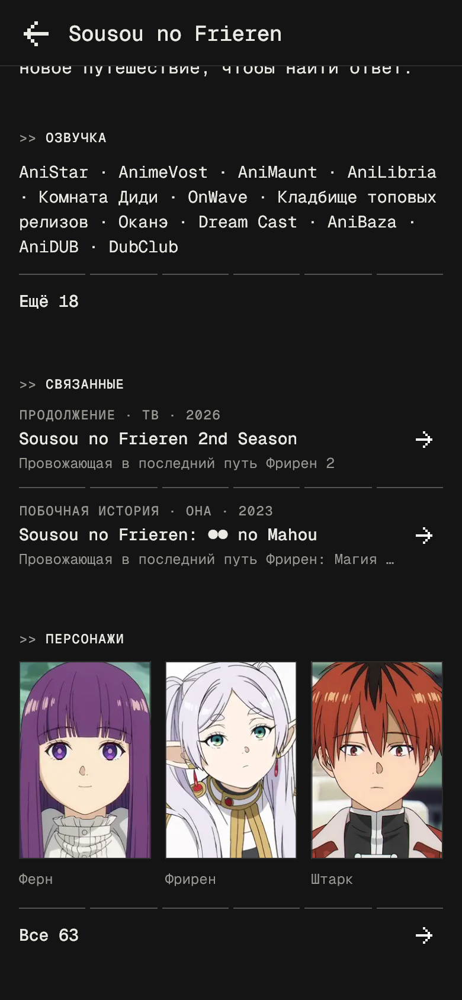
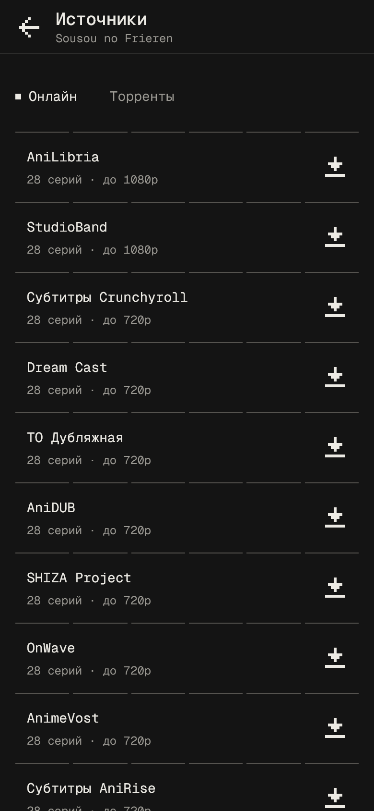
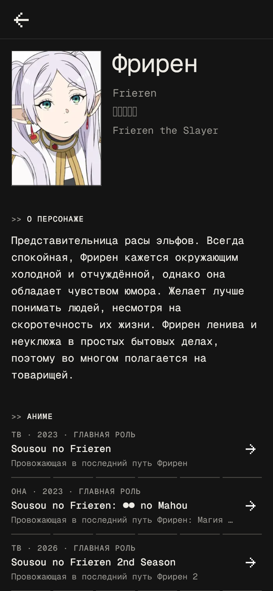

# iris

An anime app for a small circle of friends: browse the [Shikimori](https://shikimori.io) catalog, watch episodes from online dubs or torrents in the app's own player, download them for the road, and keep your Shikimori list in step as you watch. Android, Windows and iOS.

<p align="center">
  
</p>

<p align="center">
  
  
  
  
</p>

<p align="center">
  
  
</p>

## What it does

- **Catalog.** Popular titles from Shikimori, search, and filters by type, status, genre, season, rating and length. Signed in, covers show where a title stands in your list.
- **Title pages.** Facts, description, dubs, the rest of the franchise, characters (each with a page of their own) and which friends have the title in their lists.
- **Sources.** Online releases in dozens of dubs and subtitles (AniLibria, yummy_anime through Kodik and Aksor), matched to the title by its Shikimori id, and torrents from Nyaa. Magnet links of your own live in the Torrents tab.
- **Player.** mpv through `media_kit`, with the app's own full-screen controls on every platform. On phones: swipe to seek, set the brightness, lock the screen. Audio and subtitle tracks, subtitle styling, playback speed, the decoder. It skips openings (from chapters or [AniSkip](https://api.aniskip.com)), offers the next episode and resumes where you stopped. Torrents stream piece by piece, without downloading the whole file first.
- **Downloads.** Torrent files and online episodes in the quality you pick, queued one at a time, resumed after a pause, a failure or a restart.
- **Shikimori account.** Set a title's status, score and episodes. An episode watched to its ending counts in your list. Episodes your list counts show as watched on every device, and Up next picks up from there.
- **Updates.** On Android and Windows the app offers a newer release from this repository's Releases page.

How each of these behaves in detail, and which services it asks, is in [docs/behaviour.md](docs/behaviour.md).

## Install

Builds are on the [Releases](https://github.com/kstkarus/iris/releases) page:

- **Android:** `iris-X.Y.Z-android.apk`. Later versions install over it, and the app says when one is out.
- **Windows:** `iris-X.Y.Z-windows-x64.zip`. Unpack it anywhere and run `iris.exe`. To update, unpack the new archive over the old folder.
- **iOS:** there is no side-loaded build; build it from source.

## Development

Requirements: Flutter (stable, see `FLUTTER_VERSION` in `.github/workflows/release.yml`), Android Studio for Android, and Visual Studio 2022 with "Desktop development with C++" for Windows.

```bash
flutter pub get
flutter run --dart-define-from-file=config/shikimori.json
flutter run -d windows --dart-define-from-file=config/shikimori.json
```

Shikimori sign-in needs the OAuth application's id and secret, which stay out of git. Copy `config/shikimori.example.json` to `config/shikimori.json` (ignored) and fill it in from https://shikimori.io/oauth/applications. The application must list `iris://oauth/callback` and `http://127.0.0.1:43821/oauth/callback` as redirect URIs and allow the `user_rates` scope. Without the file the app still builds and runs, and the Profile tab says sign-in is not set up. The secret ends up inside the built app, where it can be read out; that is accepted for an app shared among friends.

Before calling a change done:

```bash
dart format .
flutter analyze
flutter test
```

After editing `lib/l10n/*.arb`, regenerate the localizations with `flutter gen-l10n`.

The code is organised by feature (`lib/features/<feature>/{presentation,domain,data}`), with shared pieces in `lib/shared` and `lib/entities`. The conventions, the stack and the rules for the player are in [AGENTS.md](AGENTS.md).

The screenshots above are rendered by `flutter test .design/readme_screens_test.dart` from real Shikimori and online-source answers. The `.design` folder is local and not in git.

## Releases

Pushing a tag `vX.Y.Z` runs `.github/workflows/release.yml`. It builds the APK and the Windows archive, with the tag as the version name and the run number as the build number, and publishes them as a GitHub release:

```bash
git tag v1.1.0
git push origin v1.1.0
```

The workflow needs two repository secrets (Settings → Secrets and variables → Actions):

- `ANDROID_DEBUG_KEYSTORE`: base64 of the keystore the APKs already installed were signed with (`~/.android/debug.keystore` of the machine that built them; release builds are signed with the debug key, see `android/app/build.gradle.kts`). Android installs an update only over the same signature, so the workflow stops without it. On Windows: `[Convert]::ToBase64String([IO.File]::ReadAllBytes("$env:USERPROFILE\.android\debug.keystore"))`.
- `SHIKIMORI_CONFIG`: the contents of `config/shikimori.json`.

The app asks GitHub for the latest release once per launch (`lib/features/app_update/`). When it is newer than the running version, a strip says so: above the tabs on phones, under the top bar on wider windows. Download opens the build in the browser, and Later hides that version until a newer one comes out. A failed check shows nothing.
